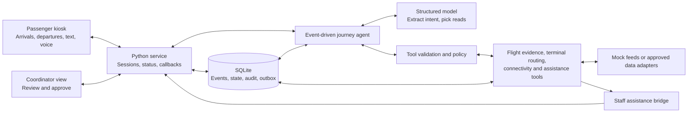
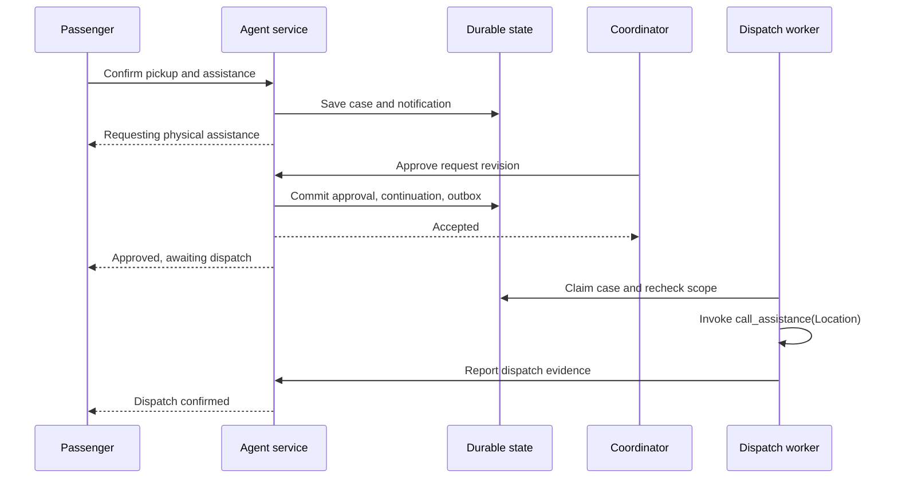

# SkyAssist implementation plan

SkyAssist is a passenger-facing connection agent for airport kiosks. It resolves the passenger’s flights and location, checks the current gate and boarding deadline, calculates a usable terminal route, and watches for changes while the journey is active. For a family waiting for a wheelchair, it stages a request and continues to track the connection while a coordinator makes the dispatch decision. This plan gives the competition team the interfaces, fixture data, screen states, and acceptance tests needed to build it.

**Target submission.** A Python and SQLite app that passes ten reproducible connection scenarios and demonstrates an asynchronous coordinator approval from a second process. The first demo should work with the internet disconnected. AirLabs, aircraft tracking, and a real airport deployment each have their own data and readiness requirements. [Competition brief](</home/fazinahamed/.t3/userdata/attachments/17d292e8-383b-4024-a07a-c7621cae0fea-6b84a035-5969-44a5-9464-f94921ca4e57-docx.docx>)

**Jump to** [Agent architecture](#2-architecture-and-agent-loop) · [Tool repair](#3-tool-contracts-and-repair) · [Connection math](#4-flight-evidence-and-connection-math) · [Assistance workflow](#5-asynchronous-mobility-approval-and-gate-holds) · [Kiosk design](#6-kiosk-design-system-and-passenger-flows) · [Data plan](#7-data-acquisition-and-fixture-generation) · [Scenario tests](#8-required-scenario-tests) · [Build sequence](#10-build-sequence-and-demo-checklist)

## 1. Scope and priorities

| Priority | Deliverable | Done when |
| --- | --- | --- |
| Competition core | Connection agent, mock telemetry, deterministic route and transfer time, mobility callback, coordinator view | Ten fixture scenarios pass from the passenger entry point. The live demo shows a changed gate, verified transfer math, a pending request, and an externally approved update while the kiosk remains responsive. |
| Kiosk features | Arrivals and Departures tabs, flight details, landmark search, route graphic, **Take me there**, **Request physical assistance**, push-to-talk | Both tabs work from mock data. Each action has a keyboard or touch path, a trustworthy unavailable state, and a clear next action. The motion map and voice can fail independently. |
| Provider integrations | AirLabs flight board and details, one aircraft-position provider, arrivals estimate hook | Adapters pass contract tests. A provider outage leaves the demo and the verified indoor guidance path usable. |
| Competition stretch | Delayed mobility-aid or stroller alerts, quiet-room and family amenity suggestions, reviewed Arabic and English audio/visual direction cards | Each stretch ships behind its own acceptance tests and uses the same evidence and routing rules. |
| Airport pilot | Operator feeds and floor plans, authorized staff integration, airport-specific policy pack, field validation and support ownership | Airport operations, accessibility, security, and privacy owners approve a restricted pilot after a read-only trial. |

**Implementation decision.** Use Streamlit for the competition kiosk and coordinator dashboard because it is in the brief’s standardized environment. Run the Python agent and callback interface as a separate service so a Streamlit rerun, browser refresh, or kiosk restart cannot own or interrupt a pending request. CustomTkinter can consume the same interface as a desktop client if the team wants a standalone kiosk shell. Confirm the competition launcher, supported Python version, model weights, and backup credentials during the pre-event check. [Competition brief](</home/fazinahamed/.t3/userdata/attachments/17d292e8-383b-4024-a07a-c7621cae0fea-6b84a035-5969-44a5-9464-f94921ca4e57-docx.docx>)

**Passenger promise.** Show the verified gate, boarding cutoff, accessible next step, and assistance state at a glance. Staff own physical dispatch and gate-hold decisions. Airline or airport records supply flight status, cutoff, and gate changes. Boarding may close earlier than a displayed prediction, so the UI expresses connection likelihood as an estimate and preserves the source and time.

## 2. Architecture and agent loop



| Component | Responsibilities |
| --- | --- |
| Streamlit kiosk and staff views | Submit input, render server-owned view models, watch by revision, show accessible alternatives. Separate staff authentication and permissions from passenger sessions. |
| Python service | Expose journey input, view state and staff callbacks. Use typed input and output contracts and an `asyncio` runner. A small ASGI service such as FastAPI fits the API boundary. |
| Agent | Maintain an active journey, choose allowed read tools, compare evidence, choose the next safe passenger or staff action, and re-evaluate on new evidence. |
| Model | Map text or push-to-talk transcripts to constrained intent and slots. Propose evidence retrieval and help phrase an answer. The server supplies protected values and controls every state change. |
| Policy and tools | Validate tool requests and results, resolve evidence, enforce passage and assistance permissions, compute transfer math, and publish typed facts for display. |
| SQLite | Persist journey state, source observations, events, assistance state and outbox. One local database on a supported local filesystem. Use explicit transactions, foreign keys, WAL and short writes. [SQLite WAL](https://www.sqlite.org/wal.html) |
| External adapters | Provide mock or approved airport and aviation feeds. Convert provider payloads into versioned domain records with status, timestamps and provenance. |

### Journey lifecycle

1. **Observe.** Enqueue `passenger_input`, `flight_updated`, `gate_changed`, `facility_changed`, `refresh_due`, `coordinator_decided`, or a dispatch status update. Use durable event IDs and a per-journey revision. Coalesce repeated refreshes.
2. **Resolve.** Identify inbound and outbound dated flight legs, the airport, party needs and a candidate landmark. Prompt for a choice when plausible interpretations change the route or pickup. If the kiosk location is managed and the passenger confirms it is their current spot, use that known node.
3. **Read.** Get flight and gate observations and, if the route is eligible, compute transfer estimates. Independent read calls can run concurrently. Validate returned data before any use.
4. **Decide and act.** Apply policy to the current facts. Publish the gate, next step, reason, transfer range, and cutoff or missing data. Stage assistance when requested with confirmed pickup. A vague need can prompt an offer while routing and telemetry continue.
5. **Persist and publish.** Commit state, event outcome and outbound work together. Apply updates for the current revision only. If a provider responds after a newer event, re-evaluate its evidence against the newer state before publishing.
6. **Wait and wake.** Subscribe to relevant events, schedule the next check, and yield control. Pending assistance parks the dispatch branch. Other journeys, gate updates and remaining connection checks continue automatically. End monitoring at opt-out, handoff completion, the configured session horizon, or when the journey is closed. Keep pending staff cases under staff workflow and retention even if the kiosk session resets.

Run a shared provider refresh per airport and time window with budget-aware cadence, then fan out changed records to affected journeys. On a new gate or facility closure, revoke the old route before exposing a replacement and reassess pending staff proposals. A model call is useful at new natural-language input or for optional phrasing. Gate and deadline updates use the deterministic path. Limit each turn to four logical read calls, one model clarification or retry, and an initial eight-second wall-clock budget. When the budget expires, commit the available facts and queue any necessary background refresh. These budgets are starting values to tune on the event laptop.

### Service interface

| Proposed interface | Contract |
| --- | --- |
| `GET /flights` | Airport, direction and bounded time window. Returns a paginated board with source and freshness. Both kiosk tabs use it. |
| `POST /journeys`, `POST /journeys/{id}/inputs` | Start a scoped kiosk session or accept a typed input. Use a client input ID for duplicate detection. Return the committed revision or acknowledgment of durable work. |
| `GET /journeys/{id}` | Return a view model for the current revision with reason codes and a source timestamp. A kiosk can poll by known revision and skip identical updates. |
| `POST /journeys/{id}/assistance` | Confirm service and pickup. Check the current input revision, consent, pickup eligibility and case deduplication. |
| `GET /staff/cases`, `POST /staff/cases/{id}/decisions` | Scoped staff queue and authenticated callback for a pending decision and revision. A separate integration status callback accepts dispatch evidence. |
| `GET /route/{token}` | Public handoff limited to approved public wayfinding steps. Recheck token lifetime and route revision whenever the page loads. |

### Model boundary

- Use intents such as `check_connection`, `find_gate`, `find_amenity`, `request_assistance`, `arrival_estimates` and `unknown`. Extract flight aliases, landmark text, language and stated access or mobility needs. Give the model structured outputs with strict schemas and an allowlist of read tools. Start with local Ollama/Qwen3 after measuring its structured calls. Benchmark a permitted hosted fallback on de-identified fixtures. [Ollama structured outputs](https://docs.ollama.com/capabilities/structured-outputs)
- Render gate, status, time, instructions, assistance state and links from validated fields and reviewed templates. Optional model prose can paraphrase a server-provided reason code and approved amenity facts. Use templates on mismatch, timeout or unavailable model.
- Typed controls and flight selectors take a direct service path. If speech recognition is unavailable or uncertain, show typed inputs and editable transcripts. Confirm who needs assistance and where through the same confirmation screen for voice and text.
- Treat prompts, transcripts, feed strings, staff notes and retrieved text as untrusted data. Keep them out of executable instructions. Validate output schemas, escape displayed text, use a static registry of tools and URL hosts, and require structured reason codes for operational decisions.

## 3. Tool contracts and repair

### Tool surface

| Contract | Required input | Output and authority |
| --- | --- | --- |
| `get_flight_and_gate_status(refs, airport, as_of)` | Resolved flight legs, session airport and service clock | Per-field observations for gate, terminal, status, schedule and cutoff if supplied. Includes source, observation time, expiry and conflict or unknown state. |
| `calculate_terminal_transfer_time(origin_id, gate_id, profile, as_of)` | Confirmed nodes, accessibility profile and time. Service loads approved map and overlay versions. | Route ID, ordered public steps, floor shapes, movement and wait ranges, safety buffer, feasibility inputs and reason codes. |
| `request_mobility_dispatch_async(case)` | Policy-created proposal with consent, verified pickup, service type, unique request ID and revision | Durable request reference and current status. Internal service entry point invoked after policy evaluation. |
| `call_assistance(Location)` | Canonical pickup value and case context bound by the service | User-written integration hook. Called by an approved outbox job once logically per request. Until implemented, a mock records the approved handoff and a separate simulated staff action can mark it dispatched. |
| `receive_assistance_decision(decision)` | Role-authorized request ID, approval version, unique event ID and decision | Applies the state transition or returns the existing/stale result. Second program calls a thin Python client for the authenticated service endpoint. |
| `get_arrival_estimates(arrival, journey_type)` | Flight leg, airport, passenger flow | User-written provider hook with baggage, immigration and security ranges independently nullable, each with source, timestamp, and applicability. |
| `get_aircraft_position(leg)` | Confirmed leg and provider identity match | Optional position, observed time, match evidence and freshness. Aircraft display only. |

Each read returns a typed success value or a classified error such as `ambiguous`, `missing`, `stale`, `conflict`, `rate_limited`, `timeout`, or `unavailable`. Feed adapters also validate response shape, coordinate range, timestamps, airport scope and codeshare identity. Tool response text never grants authority.

### Validate first, repair only when meaning is preserved

1. Decode structured arguments with limits on size and depth. Reject duplicate JSON keys and unknown tools. Validate strictly before any repair or network call.
2. For allowlisted read tools, apply at most one deterministic repair pass using the validator’s issue location. Examples include trimming documented whitespace, canonicalizing case on a code that is explicitly case-insensitive, or decoding a stringified list when the declared input requires a list of the same validated identifiers. Use an explicit alias table. Repair rules preserve values and cardinality. Revalidate structure and resolve against permitted entities.
3. Turn unresolved read errors into a brief machine-readable diagnostic, such as `AMBIGUOUS_FLIGHT` with permitted choices. Give the model one retry within the turn budget when the source evidence can resolve it. Ask the passenger when the underlying facts are ambiguous. Return a safe fallback when input is unsupported.
4. Require exact typed inputs for commits, approvals and dispatch. A semantic error, missing approval, conflicting cutoff, wrong airport, stale revision, or ambiguous pickup blocks the operation. Dispatch is callable from policy-owned code only. A read repair never acquires dispatch authority.
5. Separate argument repair from network recovery. Use a deadline, up to one in-turn retry for transient reads, jittered backoff for background reads, and honor provider `Retry-After`. Authentication and permission failures disable the adapter until fixed. Cache recent observations with their original age and provenance. After an ambiguous effect timeout, reconcile via the request’s idempotency key or staff before retrying.
6. Record tool ID, schema and repair-rule version, sanitized error class, rule ID, attempts, duration, and outcome. Omit raw passenger text, transcripts, coordinates of private pickups, credentials and callback tokens from telemetry.

Example. A string-encoded array can be repaired into a list for a read-only flight lookup. The alias `DXB-402` can resolve to a single synthetic leg if the fixture catalog says so. Two matching dated legs require a passenger choice or confirmed date. Source evidence supplies every gate, time and pickup point. Adopt the validate-first pattern from Command Code and measure its behavior on SkyAssist’s own workload. [Command Code tool-call repairs](https://commandcode.ai/docs/harness-engineering/tool-call-repairs)

## 4. Flight evidence and connection math

### Evidence rules

| Fact | Source for airport use | Behavior with weak evidence |
| --- | --- | --- |
| Operating leg and gate | Per-field precedence set with airline or airport operations. AirLabs can populate a live information board with provenance. | Confirm flight date and disambiguate operating leg, codeshare, origin and destination before route selection. A stale gate or unresolved conflict suppresses gate-dependent instructions and QR. |
| Boarding cutoff | Airline or airport operational feed, or explicit, approved, scoped airline rule with an estimate label. Mock events carry their own cutoffs. | Show **Boarding cutoff unavailable** if none is eligible. A departure time and a boarding cutoff are separate fields. An estimated rule can inform urgency, with an on-time verdict requiring a verified cutoff. |
| Location and route | Passenger-confirmed or managed kiosk landmark, operator-approved graph and current access data | Offer canonical landmark choices. A missing elevator or security-state update on a mandatory accessible edge suppresses that edge according to the airport’s evidence policy. |
| Passenger and flight readiness | Passenger-reported readiness or verified arrival and staff events | Parked, doors open, ready to move and mobility support dispatched are distinct states. An awaited wheelchair or mandatory handoff can block movement even if the connection appears possible. |
| Aircraft point | Licensed tracking provider with a leg match and valid observation time | Show **Position unavailable** if missing or unmatched. Display a clearly aged last report when allowed. |
| Baggage, immigration, security | Airport or carrier estimate feed or the documented mock hook | Show estimates as ranges and mark each as applicable, unknown or stale. Airport-arrival queues never substitute automatically for connection queue data. |

Represent timestamps as UTC instants, render DXB and AUH in `Asia/Dubai`, and identify flight legs by operating carrier/number, dated scheduled operation and endpoints or a provider’s stable leg ID. Keep scheduled, estimated and actual event times separate. Use `observed_at`, `received_at` and `valid_until`; cache reads leave those clocks intact. Merge authority per field on configured source policy. Only compare source timestamps on equivalent observations. Disagreement between equally authoritative fresh sources produces `conflict`, with no automatic gate routing until resolved. Handle changes and withdrawals as explicit events. As initial demo settings, refresh active gates every 20 seconds where budgets permit, flag as stale at 90 seconds, and label aircraft positions older than 60 seconds as last reported, hiding them after 180 seconds. Fixtures use a simulated clock. Airport owners set actual freshness and stale-use policies.

### Deterministic routing and timing

Use a directed graph of passenger-approved passages. Nodes carry airport, terminal, concourse, floor, security zone, human-recognizable landmark and map position. Edges include corridor distance, steps or slope, lift availability, allowed passenger flow, transfer train or checkpoint waits, accessibility, closures and operating hours. Exclude restricted, closed or unverified required edges. Preserve the security zone and direction through every hop. A vehicle or staff-only edge requires documented eligibility and operational authorization. Never direct a passenger into an aircraft door or apron path.

For the demo, use nonnegative integer seconds and Dijkstra on accessible edges weighted by conservative transfer duration. Use stable edge-ID ordering for equal routes. Current wait ranges come from the route’s checkpoint or transit data. For a demo edge that can change availability during travel, require it to be open through the expected traversal window or leave it out. Pilot work can add time-dependent routing once operators supply reliable schedules and traversal rules.

```text
transfer_lower = ready_lower + movement_lower + required_wait_lower + safety_buffer
transfer_upper = ready_upper + movement_upper + required_wait_upper + safety_buffer
time_remaining = boarding_cutoff - as_of
conservative_margin = time_remaining - transfer_upper
```

- Derive movement from distance and approved speed bands by profile. Add crossing, lift, shuttle, screening or handoff time once per applicable segment. `ready` covers time before the passenger can start the route. If a staff handoff is pending, show the prediction as conditional, keep the route’s next action on the confirmed meeting point, and display which part is still pending. When a required queue has no validated upper bound, withhold the conservative margin.
- Apply a hard priority buffer by party profile in Python. Demo floors are 3 minutes for a standard journey, 5 for families, and 7 for reduced-mobility journeys. A combined family and mobility profile uses the higher floor. Site or route policy may increase it. Store fixture ranges and policy versions separately so a model suggestion cannot lower a buffer. These are competition assumptions.
- With a verified cutoff, negative time remaining means **Boarding cutoff passed**, even if the route is unavailable. Otherwise, an unknown gate, required wait, cutoff or accessible path yields **Timing unverified** with a specific reason. With known timing, a conservative margin from 0 to 10 minutes inclusive means **Tight connection**, and above 10 minutes means **Time available**. For a negative margin, compare the cutoff with the quickest lower bound across eligible routes. If even that bound exceeds the cutoff, show **Transfer unlikely before cutoff**. If the optimistic time fits, show **May miss boarding**. Use the existing graph search with lower-bound weights for this second check. Assistance approval triggers a fresh evaluation with the same evidence requirements.
- Display a conservative range rounded outward for readability, and evaluate in seconds. A useful route can be shown independently of timing when its own evidence is valid. Separate estimate guidance from instructions requiring staff action. Recalculate on changes to gate, facility, wait or readiness.

## 5. Asynchronous mobility approval and gate holds

### State and transitions

| State | Entered by | Passenger view |
| --- | --- | --- |
| `draft` | Passenger opens assistance or accepts an offer | Confirm closest landmark, what support is needed, and whether the passenger can stay at that pickup. |
| `pending_approval` | Passenger confirms the request in the current scoped kiosk session. Service commits request and coordinator notification. | **Requesting physical assistance** with a clear waiting message, confirmed pickup, case reference if helpful and a static alternative to animation. Route updates and a staff-contact option stay reachable. |
| `approved` | A valid staff callback approves this revision | **Assistance approved. Awaiting dispatch confirmation.** |
| `dispatch_pending_verification` | Dispatch transport times out with an unknown outcome | **Staff are checking the dispatch.** Keep the case with the coordinator for reconciliation. |
| `dispatched` | Staff or trusted provider reports dispatch with a matching case | **Assistance dispatched.** Show an ETA only with a valid dispatch estimate. |
| `completed` | Staff closes the case or a configured trusted integration confirms handoff | **Assistance complete** and the latest route or staff next step. |
| `declined`, `cancelled`, `expired` | Staff declines, eligible cancellation succeeds, or the approval window expires | Show reason when appropriate with a verified staffed alternative. After dispatch, a cancellation request goes to staff. |

1. The passenger confirms pickup and service. Generate a request ID and revision and persist the case, journey continuation, and notification event in one transaction. A stable submission ID or existing open case prevents multiple cases from repeated taps. Treat requests as pending until the durable write succeeds.
2. Staff review verified pickup, service type, current gate and its revision, deadline, priority reason and time remaining. Staff can approve or decline. An unknown or unconfirmed pickup goes to a staff contact flow with no automatic dispatch action.
3. The callback verifies staff role and case scope. Authenticate the calling connector or staff session. Validate unique event ID, request revision, expiry and current `pending_approval` state in the same transaction. Replays return the committed outcome. A late approval after cancellation, expiry or material revision is recorded and rejected. Any conflicting second decision returns the first committed state. Expiring approval windows go to the configured staffed fallback, with the approval window visible.
4. Write approval, a continuation event and an outbox dispatch record atomically. Return from the callback promptly. A worker claims the outbox record and checks the revision, gate, pickup and eligibility in the claim transaction. Persist an in-flight marker before calling the external provider and carry the stable case key through that call. A revision change before claim cancels the queued dispatch or requires a new approval if the approved scope changed. During or after an external call, send any scope-changing update to staff for amendment or reconciliation. Expired in-flight claims use provider deduplication or reconciliation before another send. A gate change affecting only directions can re-render guidance while preserving a pickup approval still within scope. A gate hold always binds the target flight and cutoff or gate revision.
5. The worker invokes the supplied `call_assistance(Location)` hook only after approval. Internally use an adapter that passes request ID and version so a real integration can support deduplication or status lookup. A blocking hook runs off the event loop with a deadline and explicit unknown-outcome handling. If a provider has no idempotency or status lookup, uncertain handoffs require staff reconciliation before another attempt. A coordinator approval updates the passenger immediately after commit. A later dispatch acknowledgment is a separate status update.
6. Any second Python program can use the authenticated callback client. The kiosk reads revisions through the service, with a short status refresh while pending or an event stream if useful later. Restarting the kiosk or service reloads durable state and resumes unfinished work. Staff cases do not depend on a passenger browser remaining open.



**Gate holds.** Apply the same approval and audit mechanics to a separately typed proposal. Confirm airport and airline policy for who can accept a hold and which flight it applies to. The default competition mode can show **Hold request submitted for review**. Show a changed cutoff only after a verified airline or operations event supplies it. A mobility coordinator’s approval covers the mobility case.

**Urgent safety and privacy.** Surface an airport-approved emergency contact or nearby staffed help point for urgent medical or safety issues. Use explicit passenger intent to collect only a confirmed pickup, requested aid and an anonymous case reference where possible. Keep substantive medical details out of model inputs and operational traces. Scope display, callbacks, and retention to verified roles and site policy. On a public kiosk, provide **End session** and an idle countdown with extension, then clear visible and browser-cached session data.

## 6. Kiosk design system and passenger flows

Use the supplied terminal image as the visual reference. Bring its warm white surfaces, high-contrast signage, soft teal glass, and open circulation into a flat kiosk UI. Keep warm stone tones for the canvas, deep teal for directions and primary actions, and restrained amber and red for time-sensitive states. Use an original layout with familiar airport wayfinding patterns. [Terminal reference image](/home/fazinahamed/.t3/userdata/attachments/17d292e8-383b-4024-a07a-c7621cae0fea-ca373446-72f7-4c37-a48a-bfe25d9b29fa.png) · [Dubai Airports](https://dubaiairports.ae/) · [Zayed International Airport](https://www.zayedinternationalairport.ae/)

### Layout and interaction

```text
SkyAssist   DXB Terminal Guide                         English / عربي   Help
[ Departures ] [ Arrivals ] [ Find my connection ]     [ Search flight ]

Flights                      Selected flight and next action
Flight / City / Time / Gate  Gate B14 · Concourse B · Level 2
Scrollable flight list        Boarding closes 10:35 · Tight connection
                              Step-free transfer 21–29 min total
                              From C22 · Confirm your pickup before moving

                              [ Take me there ]
                              [ Request physical assistance ]
                              [ Ask SkyAssist · microphone ]  [ Type ]

                              Route map and numbered steps
                              Aircraft position when available
```

The displayed transfer range includes readiness time. The live screen should render **21–29 min total, including readiness** for the reference case. The main panel keeps the most urgent next action above the route and aircraft maps. On a portrait kiosk, stack the flight list and detail content, with an explicit back-to-flights control. Use a shared components set for the connection view, board, and staff dashboard so status labels keep the same meaning.

| Token or component | Specification |
| --- | --- |
| Canvas and text | `#F7F6F1` canvas, `#FFFFFF` surface, `#122C30` primary text and `#426166` secondary text. White on `#005F61` primary controls. |
| Status colors | Tight `#713900` on `#FFF0D6`, warning `#8C2230` on `#FCEAED`, verified `#245941` on `#E4F2EA`, pending/info `#214F62` on `#EAF1F1`. Pair each with a label and icon. |
| Type and spacing | Source Sans 3 for Latin and Noto Sans Arabic for Arabic. Use tabular time digits, 20–24 px body, 28–32 px section titles, and 56–72 px gate numbers as starting sizes at 1440×900. Use an 8 px spacing grid and validate at kiosk distance and 200% zoom. |
| Inputs | Aim for 56×56 CSS px minimum touch targets. Provide keyboard focus, clear labels, back and cancel controls, a visible transcript, reduced motion, and announcements for meaningful state changes only. Test Arabic layout, English flight-code directionality, and screen reader order on the actual device. |
| Maps | Use simple floor diagrams, named lifts, inter-concourse transit and checkpoints. Give each turn a text equivalent and use strongly outlined controls. Aircraft map uses a separate label, timestamp, and visual hierarchy. |
| Session and wait states | Keep language, help, accessibility and end-session controls in reach. Show **Requesting physical assistance** in a status panel with pickup, current stage and staffed alternative. Use a skeleton or static label when motion is reduced. |
| QR | Use a high-contrast QR with a quiet zone, short on-screen instructions, a textual handoff alternative and an accessible label. Test scanning in terminal lighting and at intended screen distance. |

Web targets are WCAG 2.2 AA as applicable, including 4.5:1 for normal text, 3:1 for large text and relevant controls, visible keyboard focus, useful announcements and alternatives to audio and maps. Validate physical approach, reach, glare, tap ergonomics and viewing height with airport accessibility staff. A CustomTkinter shell needs separate platform assistive-technology verification before kiosk deployment. [WCAG 2.2](https://www.w3.org/TR/WCAG22/)

### Flows

- **Departures.** Use the airport and selected time window to list outbound flights by local scheduled time with current status and gate. Search by operating or marketing code or destination. Details show flight and carrier, destination, concourse, gate, scheduled and estimated departure, actual departure when available, boarding cutoff and its source or unavailability, and last verified time. Track the current flight’s gate once the passenger chooses a connection or route.
- **Arrivals.** Show origin, carrier and flight number, scheduled and estimated arrival, actual arrival, arrival gate and carousel when reported. Display baggage, immigration, and security estimates independently. Ask whether the passenger is exiting or connecting when it changes the applicable steps. Distinguish baggage claim from baggage transfer and mark security or immigration as applicable to the confirmed flow.
- **Take me there.** Resolve the nearest named landmark with exact aliases, airport context and typed search. The model may identify candidates from the passenger’s words. Let the passenger choose among ambiguous floors or concourses. Compute a graph route from the confirmed node, render a floor-by-floor graphic and numbered steps, and adapt after gate or lift changes. Name the landmarks rather than implying indoor GPS precision.
- **Phone handoff.** The main QR opens a short-lived, revocable SkyAssist route page. A token references the current route revision and public wayfinding steps only. Show **Route changed** or **Route expired** if scanned after invalidation and offer a fresh gate lookup. On the phone, offer a separate **Open pin in Google Maps** QR or link for operator-approved public coordinates, with **Map pin only** outside the indoor wayfinding flow. Generate it as a Maps search URL with `api=1` and validated coordinates. A copied external pin remains static, so keep time-sensitive directions on the SkyAssist page. For the synthetic demo, omit the real gate pin and use a synthetic route page. Phone scanning in the room needs a reachable approved endpoint or private LAN. The kiosk route works locally without a phone. [Google Maps URLs](https://developers.google.com/maps/documentation/urls/get-started)
- **Aircraft map.** Load lazily when the detail panel reaches the aircraft section. Match by operating leg using provider identity, time and airports, with ICAO24 or a comparable identifier where available. Reject an ambiguous match. Display position, source, reported time and freshness. Use a map vendor permitted for kiosk use, or a locally owned world/terminal graphic in demo mode. With public OpenStreetMap tiles, follow attribution, cache, client identification and offline restrictions. [OpenStreetMap tile usage policy](https://operations.osmfoundation.org/policies/tiles/)
- **Request physical assistance.** Pre-fill the confirmed landmark if current, then show a distinct pickup confirmation, requested aid, current gate and a submit button. Show the durable pending state and the staffed alternative. Following approval, update the same panel without interrupting navigation or resetting the session.
- **Voice.** Large labelled microphone action with push-to-talk, an on-screen recording indicator, stop and edit-transcript controls. Apply the same intent schema, evidence and consent steps as typed input. Clear temporary audio after transcription and use approved providers for any remote audio or TTS. Read critical directions from structured facts using reviewed translations and optional audio. Text stays available in noisy or quiet terminal settings.

## 7. Data acquisition and fixture generation

| Dataset | Build approach | Practical limits |
| --- | --- | --- |
| Terminal wayfinding | Hand-author a small fictional hub based on the brief’s concourse idea. Capture nodes, geometry, floors, edge traversal rules, elevator and checkpoint states, signage and landmark aliases. Draw a matching floor chart. | Mark it **Simulation · Fictional terminal map** on routes and QR pages. For an airport pilot, obtain operator-approved floor plans, surveyed geometry, restrictions, closures and public anchors. Treat each airport as its own configuration and map. |
| Flights and cutoffs | Seed plausible dated arrivals and departures and the supplied `DXB-402` alias. Define event sequences for gate reassignment, delays, updates, cancellations and missing cutoff. | AirLabs schedules can filter on `dep_iata=DXB` or `arr_iata=DXB`. They document gate, status, estimated and actual times, codeshare fields and arrival carousel. Boarding cutoff needs separate evidence. Check sample coverage, freshness, plan limits, reuse terms and timezone behavior before enabling. [AirLabs DXB API](https://airlabs.co/dubai-international-airport-api) · [Schedules reference](https://airlabs.co/docs/schedules) |
| Airport metadata | Pin a version of OurAirports or operator-supplied data for airport codes, names and public centroids. Keep source and revision in the data manifest. | Airport centroids are useful for the aircraft map. Floor plans, gate coordinates and pushback times need their own sources. [OurAirports dataset](https://github.com/davidmegginson/ourairports-data) |
| Aircraft positions | Generate a short synthetic trace for demo mode. Choose AirLabs flights for the first integration spike to reuse the provider. Evaluate FR24 or OpenSky if coverage, terms and quota fit. | Use documented API access, with provider-specific timestamps and aircraft/leg matching. Check redistribution/display rights and account costs for any feed. Avoid screen scraping. [AirLabs flights](https://airlabs.co/docs/flights) · [Flightradar24 developer docs](https://fr24api.flightradar24.com/docs/getting-started) · [OpenSky REST API](https://openskynetwork.github.io/opensky-api/rest.html) |
| Assistance and arrivals | Write synthetic assistance records with canonical pickup, aid type, revision and timed staff responses. Provide mock queue ranges, baggage event types and applicability for connecting and exiting flows. | Use anonymous fixtures and fictitious people. Airport or airline partners supply current queue, baggage and mobility data for airport operation. The integration hooks return explicit unavailable states until wired. |
| Family amenities | Seed a few lounges, restrooms, help desks, play areas and quiet rooms with access zone, opening hours, eligibility, floor and access attributes. | Recommend only verified open places reachable under current eligibility. Use a return-route estimate and preserved boarding margin before suggesting a diversion. |

### Seed and replay workflow

1. Create versioned files for nodes/edges and route shapes, dated legs/codeshares, a timestamped event stream, approved landmark aliases, site policy and one scenario manifest. Generate a fresh demo database from these inputs. Keep seeds readable and deterministic.
2. Start with roughly 20–30 nodes across two fictional concourses, including a level change, a train or shuttle, two checkpoints with different eligibility, alternative routes, nearby landmarks with the same name and an elevator closure. Use directed edges and separate entry/exit rules. Give gates companion public nodes.
3. Add at least 12 fixture legs spanning one local midnight, two codeshares, distinct boarding cutoffs and multiple stale or conflicting observations. Use named test clocks rather than the system clock. Build small de-identified provider response fixtures for adapter contracts only if their terms allow retention.
4. Define scenario IDs, starting clock, events, expected route node sequence, earliest/latest transfer, expected status, allowed outbound effects and required passenger action. Review golden outputs independently against the floor plan and math. A generator can add phrasing variants or corrupted payloads. Human-reviewed fixtures anchor the expected behavior.
5. Validate all foreign keys, directed edge restrictions, access coverage, geometry bounds, timezone parsing, unique leg IDs, scenario reachability and provenance on build. Lint for real personal identifiers, missing source metadata and demo/live mixing. Export the dataset manifest with dataset version, generator seed, policy and graph versions, licenses and known gaps.
6. Run demo and live in separate stores and config profiles. The demo uses its replay clock, mock provider registry and simulated callbacks. Live fields carry their own source and last observation; failed live requests stay visibly stale or unavailable. A process can start in one mode only.

**Minimum persisted data.** Use separate entities for flight legs and aliases, per-field observations, terminal nodes/edges and overlays, queue or amenity observations, journeys and revisions, cases and staff decisions, durable events/outbox, and minimal audit records. Use uniqueness constraints for event IDs, idempotency keys and one equivalent open case per journey. Index due work, active journey by leg and current observations by fact/source.

### Stretch event rules

| Stretch | Trigger and useful result | Acceptance check |
| --- | --- | --- |
| Stroller or wheelchair tracker | Passenger opts in with a scoped item reference. A trusted delay event or an expired confirmed delivery window triggers one alert per status revision. Explain current handoff location and who can help. | A delayed item generates one alert. Replayed updates generate none. A carousel assignment alone shows claim location, while a separate handoff event is required to show the item is ready. |
| Family amenities and quiet rooms | A delay leaves enough verified time for an eligible out-and-back route, a stay interval and the existing boarding buffer. A gate change or shortened cutoff rechecks the suggestion. | An open, reachable quiet room is suggested for a fixture layover. A closed facility, inaccessible path, unknown cutoff or lost time margin removes the suggestion. |
| Multilingual route cards | Render reviewed English and Arabic templates from the same route facts. Include floor, landmark and accessible mode. Optional local TTS reads the rendered route. | Language changes preserve every gate, deadline, negation and direction. A native reviewer checks right-to-left layout and mixed Arabic text with flight codes. The text card works with audio disabled. |

## 8. Required scenario tests

Each row is an end-to-end passenger fixture with independently reviewed route and status expectations. Evidence queries and clock changes run through the same service as the kiosk. The fixture values below are synthetic.

| ID | Input and event sequence | Expected result |
| --- | --- | --- |
| C01 | `DXB-402` is parked at C22. Outbound gate reassigned to B14. At 10:00 DXB time, verified boarding cutoff is 10:35. Family needs a wheelchair handoff. | Proposed step-free path C22 → Lift C → Train C → Train B → B14. Readiness 4–6 min + movement 7–9 + required wait 3–7 + mobility buffer 7 = 21–29 min and 6 min conservative margin. Next step is staff handoff at a confirmed pickup. Request pending, external approval, then separate dispatch acknowledgment. |
| C02 | Path to B14 is already displayed, then trusted gate event changes it to B18 while a generic pickup case is pending. Start time and boarding cutoff give 32 minutes remaining. | Invalidate B14 route and QR before republishing. New path reaches B18 with a planned 16-minute upper bound and 16-minute margin. Preserve the pickup case only if its proposed service and pickup still apply. |
| C03 | Standard traveler with a verified same-concourse gate and 40 minutes left. Fixture movement 5–8 min, no wait, ready now. | Direct route, 8–11 min after buffer, 29-minute margin, **Time available**. No coordinator case. |
| C04 | Family has 8 minutes before a verified cutoff. Best permitted route yields movement and waits of 7–17 min, ready now. | 12–22 min after family buffer, **Transfer unlikely before cutoff**. Offer verified staffed next steps and human review where eligible. Changing the simulated clock past cutoff surfaces **Boarding cutoff passed**. |
| C05 | Flight has ETD and a verified gate, with no cutoff or approved estimation rule. | Valid indoor route with **Boarding cutoff unavailable** and **Timing unverified**. No boarding-time inference and no on-time prediction. |
| C06 | Gate evidence passes expiry, followed by two fresh conflicting authorities with equal policy priority. | Stale and conflicting states suppress gate routing and QR. On a newer authoritative resolution, show the route for the resolved gate. |
| C07 | Passenger enters “Costa” and two plausible landmarks remain on different floors. Passenger confirms the upper-level match. | Ask for floor or landmark choice before route calculation or staff submission. Draw the independently expected path from the selected public node. |
| C08 | Step-free route depends on a lift. A closure removes the last eligible path. A stairs-only route remains. | Explain closure, withhold stairs for the step-free profile, surface verified staffed assistance. Reopen route only after eligible lift evidence returns. |
| C09 | Marketing and operating flight aliases refer to one departure after local midnight. The same marketing code appears on another service date. At 23:50 local, verified cutoff on the selected leg is 00:18. | Resolve the correct dated operating leg and show 28 min left. A 15-minute upper bound yields 13 min margin. Prompt if the date remains ambiguous. |
| C10 | Verified connection crosses a mandatory checkpoint. Reachability is established, but the latest applicable queue upper bound is stale. | Show allowed wayfinding steps with the checkpoint and **Timing unverified**. Withhold conservative margin and any promise that boarding is reachable. Fresh queue evidence restores classification. |

Additional fault and safety tests run separately from the ten required scenarios.

- **Callback and recovery.** Cover approval, decline, expiry, replay, duplicate button taps, wrong-role callback, stale revision, gate change between approval and claim, competing approval/cancel, process crash after outbox commit, repeated claim, ambiguous post-send timeout and passenger kiosk restart. Assert effect count and ordering from the audit trace. Demo approval endpoint runs in a second process.
- **Routing and time.** Cover wrong airport, restricted edge, one-way backtracking, wrong checkpoint eligibility, stale lifts, step-free detours, date ambiguity, exact-zero margin, missing upper bound and cutoff already passed. Property-test that selected edges are eligible and that raising mandatory waits never improves a path’s calculated arrival time.
- **Tool robustness.** Run valid calls, malformed JSON, duplicate keys, oversized payloads, wrong enums, invalid times, deliberate field substitutions, unauthorized tools, and hostile instructions in provider strings. Assert original input meaning survives a repair and that each forbidden case has zero external effects.
- **Degradation.** Inject provider 429 and retry hints, quota exhaustion, stale cache, conflicting gate observations, model outage, transcription failure, missing map tiles, network loss, callback timeout and service restart. Verify the correct UI state and accessible alternative.
- **Passenger experience.** Test large text, RTL, focus order, QR scan and expiry, independent status announcements, public-session clearing and resuming a legitimate staff case after that clearing. Test short, stressed and multilingual requests using reviewable transcripts. Have a reviewer walk each route from the rendered steps alone.

## 9. Reliability targets and improvement with every change

These are proposed competition release gates. Record measured results, sample sizes and versions in the submission. Ten core scenarios demonstrate coverage of the brief. Use larger, separate suites to estimate tool reliability.

| Metric | Initial release gate and measurement |
| --- | --- |
| Core correctness | 10/10 scenarios pass at the passenger entry point. Compare gate identity, route, deadline, status and authorized effects with independent fixture expectations. |
| Safety invariants | Zero in the adversarial suite for unauthorized effects, fabricated critical facts, duplicate dispatch, stale gate directions, false dispatch confirmation or blocked restricted paths shown as usable. Each invariant runs on every relevant change. |
| Read acceptance | At least 99% of eligible read calls succeed after validation or approved repair against a healthy mock. Use at least 500 eligible calls spanning model, tool, locale and input shape. Keep initial validation success, repaired success, backend failures and safe refusals as separate counters. |
| Repair precision | All permitted repairs in the labeled regression suite preserve intent and values. Report per-rule count and accuracy. Any repaired case that changes meaning blocks promotion of that rule. Score deliberately ambiguous or unsafe inputs for correct refusal. |
| Update latency | On the event machine, target p95 ≤2 seconds from committed gate or approval event to visible state, excluding human decision time. Run at least 100 samples across normal operation and a loaded session. Target p95 ≤3 seconds for local typed connection results. Measure model and provider latency separately. |
| Recovery | A service restart recovers every durable pending case and queued event in the failure tests. Replayed decisions produce one transition. Unknown dispatch outcomes persist until reconciled. |
| Accessibility | Complete the core flow with touch, keyboard, screen reader and 200% zoom on the intended OS. Test RTL and typed/voice alternatives with native-language and accessibility reviewers before shipping those translations. |

### Feedback and promotion

1. **Capture.** Store structured correction types such as intent misread, landmark ambiguity, unsupported gate claim, repair failure, wrong feasibility status or unclear copy. Count source outages separately. Capture minimal approved event context. Treat coordinator approvals as operational outcomes. Treat a passenger's approved content or feedback as one signal for phrasing or usability.
2. **Label and reproduce.** Review corrections offline, attach a redacted reproduction and expected behavior, and add a permanent regression case. Maintain a versioned policy, prompt, model, tool schema, repair rules and data pack. Classify errors by their root source so the next change targets the correct layer.
3. **Compare.** Replay baseline and candidate against core fixtures, held-out natural language and input mutations, callbacks under race/restart, and known bad cases. Report scores by tool, locale, profile and failure class. Keep threshold calculations and actual denominators in the report.
4. **Promote selectively.** Require all safety gates and no regression in required scenarios. Check latency and read reliability against the pinned baseline and document intentional tradeoffs on noncritical metrics. Run a dry-run or shadow evaluation with external writes disabled, then promote a versioned bundle. Roll back its prompt, model, tool rules or map component together with any required compatibility step.
5. **Audit the trend.** Track weekly changes in first-pass tool success, semantic repair precision, safe refusal, escalation reasons, gate/source age, time to approval, and duplicate-attempt reconciliation. Add an incident replay for each significant failure.

Command Code Taste illustrates learning from accept, reject and correction signals. The supplied equation motivates rewarding better task outcomes while preserving behavior already proven useful. In SkyAssist, versioned rules and offline regression gates carry that idea into a high-consequence workflow. Online policy or model-weight changes stay outside the runtime. Hard safety checks apply independently of aggregate scores. [Command Code Taste](https://commandcode.ai/docs/taste) · [Objective image](/home/fazinahamed/.t3/userdata/attachments/17d292e8-383b-4024-a07a-c7621cae0fea-c2b1cf59-13f6-4e4a-b3aa-f93319ef077d.png)

## 10. Build sequence and demo checklist

| Phase | Work | Exit check |
| --- | --- | --- |
| 0. Readiness | Confirm event launcher, browser and OS, Python environment, installed Qwen3 model and fallback, local service access and a second process for coordinator callbacks. Assign owners for data/routing, agent/service, kiosk and tests. Small teams can combine roles. | Run a short structured model request, read/write SQLite and open the baseline UI on the event machine with the network disabled. |
| 1. Evidence and route slice | Build synthetic graph, time policy, flight fixtures, deterministic route tool and a text/selector-driven C01 route. Add a gate change event and provenance fields. | C01 and C02 resolve the right gate and route with hand-verified calculations. A stale gate suppresses directions. |
| 2. Durable assistance | Implement cases, staff view, async callback, outbox and the mock `call_assistance(Location)` integration. Add approval, decline, expiry and uncertainty screens. | A second process completes the callback. A kiosk or service restart preserves state. Duplicate or out-of-scope callbacks yield no duplicate dispatch. |
| 3. Agent and core suite | Connect structured language input, policy, tool repair, refresh events and fallback. Complete the ten fixtures, load and failure tests. | 10/10 core scenarios pass offline, and release gates for the core are measured. |
| 4. Kiosk completeness | Add flight tabs and details, landmark map, QR route page, staff help controls, voice input and arrivals hook states. Keep the urgent route and assistance action dominant. | An unfamiliar tester completes departure guidance, arrivals detail and mobility request. Offline and accessibility walkthroughs cover the target device. |
| 5. Provider adapters and stretch | Integrate AirLabs board, validate one position feed, then add a baggage alert or amenity stretch. Add reviewed language/audio cards if time permits. | Auth and licensing are checked. Provider, mock and denied data states are visibly distinct. The offline demo remains reliable. |
| 6. Submission rehearsal | Freeze fixtures, model, dependencies and demo clock. Prepare a reproducible launcher, seeded DB and one-page operator checklist. Show observed regression and safety results. | Two cold-start rehearsals on event equipment, one disconnected. Coordinator roles and resets work. |

**Competition demo script, about four minutes**

1. Open the synthetic DXB kiosk. Enter the wheelchair and 35-minute connection request. Show the separate facts for flight telemetry, deadline, transfer calculation and assistance state.
2. Show the step-free route and the 21–29 minute estimate. Confirm pickup and request assistance. The coordinator dashboard shows the case. While pending, demonstrate a route-affecting update using the scenario clock or a separate journey, so judges see that monitoring continues.
3. Approve from the coordinator process. Show the approval in the passenger view and then the simulated dispatch acknowledgment. Replay the decision and show one dispatch in the audit log.
4. Demonstrate a bad read repaired without semantic change and a missing cutoff that stays unknown. Show the 10-scenario output and one restart or outage test. Use the synthetic phone QR if the room’s network allows.
5. If there is time, show the arrivals estimates, an aircraft map and a stretch such as a delayed stroller alert or a reachable quiet room.

## 11. Airport pilot and rollout

| Readiness area | Evidence required for a pilot |
| --- | --- |
| Operator integration | Named gate and boarding feed owners, tested timestamp and precedence rules, an approved terminal graph and a reliable process for closures and temporary access changes. Confirm DXB and AUH separately. |
| Staff authority | Airport-approved mobility queue, documented handoffs and fallback contacts, role-based access, staff coverage and explicit airline authority for gate holds. An integration partner supports idempotency or staff reconciliation. |
| Deployment security | Kiosk lockdown, restricted outbound hosts, staff SSO or verified connector identity, authenticated encrypted traffic and role/airport scoping. Test public session isolation, callback integrity, auditable access, secret rotation and QR expiry. |
| Privacy and data rights | Airport-approved retention and deletion, data minimization and residency review, lawful microphone and analytics handling, and reviewed feed/map display and reuse rights. Avoid passenger-record integration during the competition build. |
| Field correctness | Walk routes with staff, wheelchair users and travelers with children. Check signage, lift access and queue calibration at varied times. Validate any cutoff policy with each airline. Review independent accessibility results and fit the hardware to the installation. |
| Failure ownership | Establish alerts for stale gates, missing dispatch acknowledgments and callback backlog. Agree who handles incidents, how a station falls back to verified terminal help, who can disable a feature, and what constitutes a rollback. |

Roll out to one concourse in a read-only staff trial. Compare outputs with real operating records and observed route times. Move to a limited staffed passenger pilot after field verification, approved contacts and a documented incident drill. Enable dispatch integration with a small trained staff cohort. Expand only after the operator reviews reliability, accessibility, cutoff errors and missed or duplicated handoffs.

## 12. Decisions to confirm during the build

| Decision | Plan assumption and fallback |
| --- | --- |
| Competition UI | Streamlit launcher and async service first. CustomTkinter remains an optional shell. Confirm that both processes are allowed on event hardware during phase 0. |
| AirLabs subscription and tracking coverage | Start with mock providers. Validate entitlement, quota, coverage and reuse on a real account before enabling the corresponding adapter. |
| Real gate positions and indoor maps | Synthetic competition graph. Use operator-supplied data for any real gate navigation, GPS pin or staffed-location promise. |
| Boarding cutoff and staff contracts | Verify in the synthetic event stream first. The live board remains usable when one of these operational facts is unavailable. |
| Physical assistance and arrivals functions | Mock the requested Python hooks. Agree on return schemas and authentication before attaching the user’s real scripts. |
| Learning and languages | Improve via versioned fixes and offline evals. Ship language choices only after language-specific testing and human review of critical guidance. |
